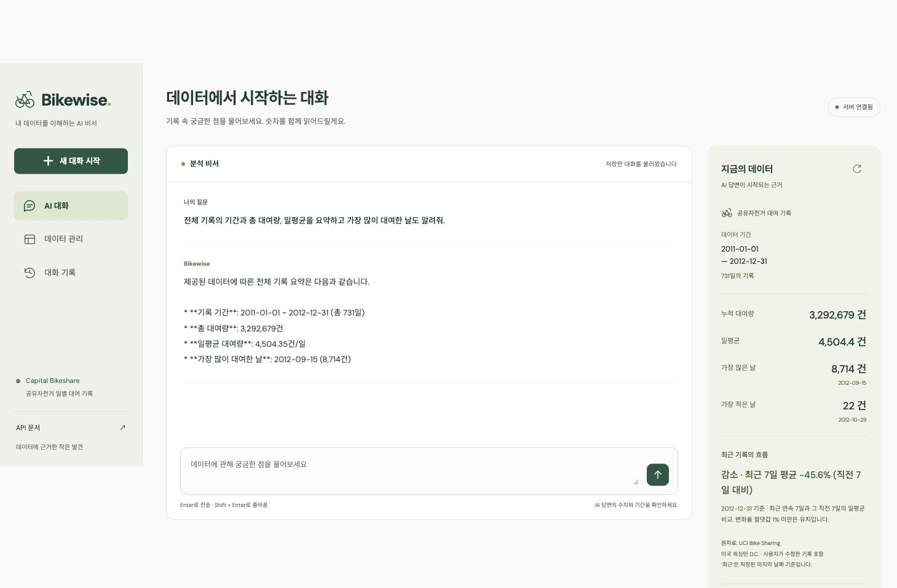
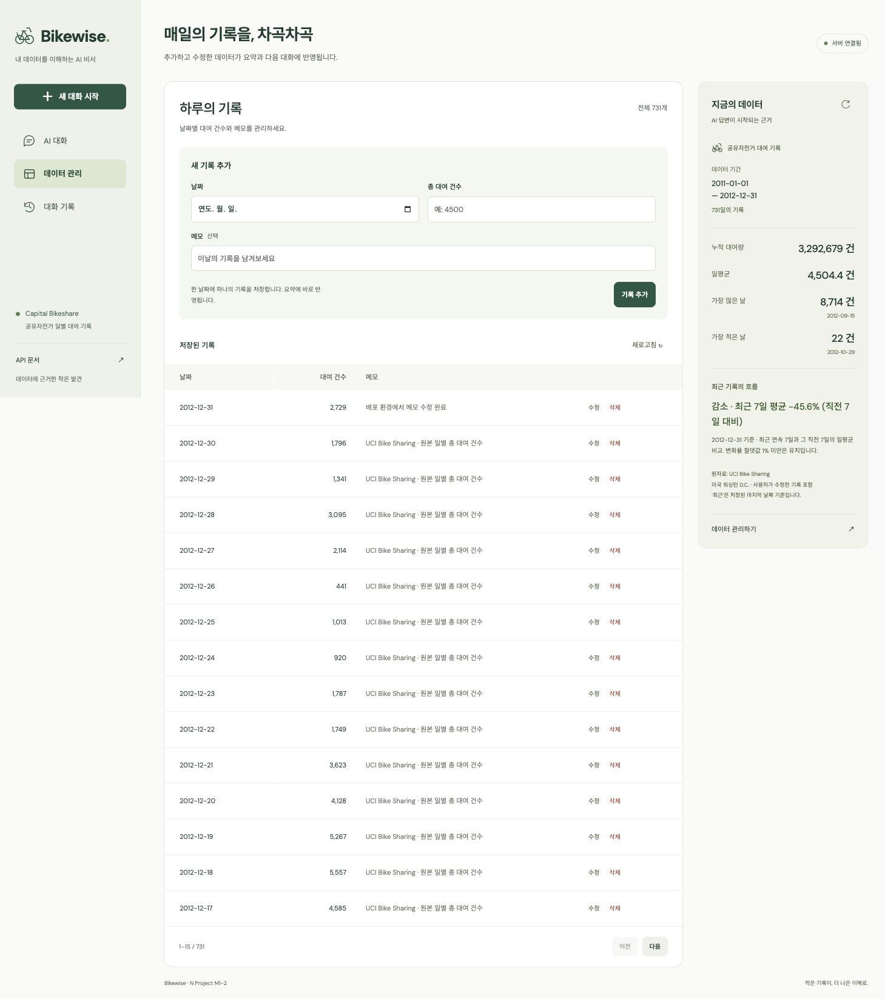
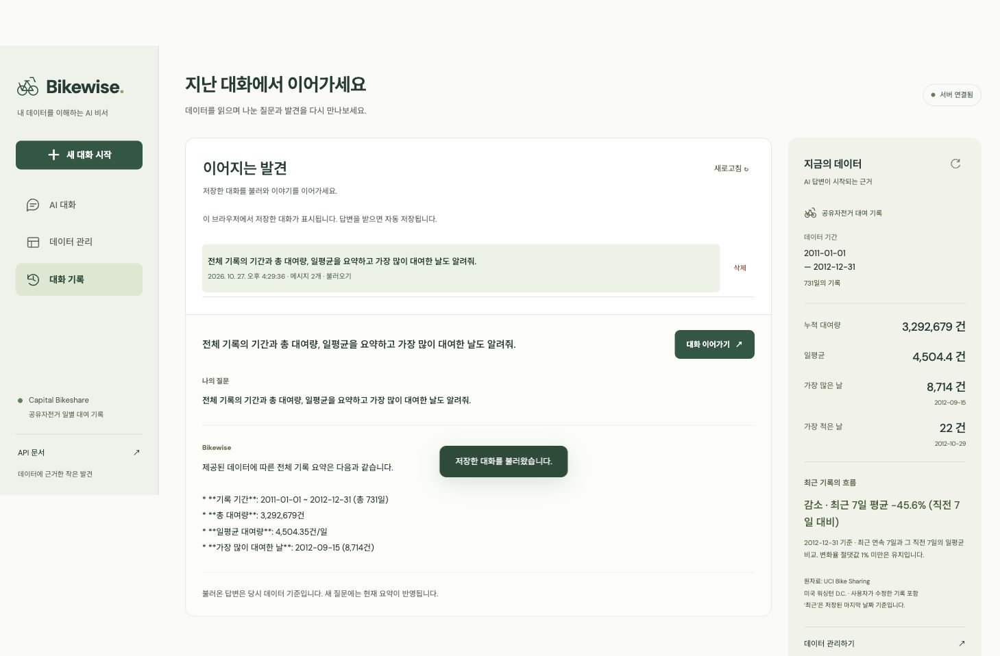

# Bikewise — 내 데이터를 이해하는 AI 비서

공유자전거 대여 기록을 관리하고, 저장된 데이터의 통계에 근거해 질문에 답하는 웹 서비스다. [M1-1 분석 프로젝트](https://github.com/larklaon/N_Project_M1-1)의 UCI Bike Sharing 일별 데이터 731개를 활용한다.

**사용자 요청에 따라 AI는 Gemini 3.8 Flash(`gemini-3.8-flash`)로 구현했다.** 과제 원문의 OpenAI/GPT API 사용 조건과 다른 부분이다. 보너스 과제는 구현 범위에서 제외했다.

**필수 기능 구현과 Render·Vercel 배포를 완료했다.** 로컬 테스트 30개를 통과했고, 실제 Firestore에 원본 731개를 적재한 뒤 배포 주소에서 Gemini 답변·대화 자동 저장·불러오기·이어가기·데이터 CRUD·요약 갱신을 확인했다. 아래 제출 스크린샷은 실제 Vercel 서비스와 Firestore·Gemini를 연결해 촬영한 화면이다.

과제의 학습 목표 6가지에 대한 개념과 실제 구현 설명은 [11. 학습 목표별 개념과 프로젝트 구현](#11-학습-목표별-개념과-프로젝트-구현)에 별도로 정리했다.

## 1. 서비스 소개와 필수 기능

일반적인 챗봇이 알지 못하는 사용자의 데이터를 서버에서 요약해 AI에게 제공한다. 데이터 수정 이후의 새 질문에는 변경된 통계가 반영된다.

| 기능 | 구현 내용 |
| --- | --- |
| 데이터 기반 AI 채팅 | DB 전체 데이터 요약 → 시스템 프롬프트 주입 → Gemini 호출 → 답변과 대화 자동 저장 |
| 로딩·오류 안내 | 답변 준비 중 표시, 중복 전송 방지, 요청 실패 시 질문 복원, 첫 서버 연결 지연 안내 |
| 데이터 CRUD | 날짜·대여 건수·메모 추가/조회/수정/삭제, 날짜 중복 방지, 목록 페이지 이동 |
| 데이터 요약 | 기간, 개수, 합계, 일평균, 최댓값·최솟값과 날짜, 최근 추세 |
| 대화 기록 | 자동 저장, API를 통한 수동 저장, 목록 조회, 전체 메시지 불러오기, 이어가기, 삭제 |
| API 문서 | FastAPI Swagger `/docs`, OpenAPI `/openapi.json` |
| 배포 준비 | Render Blueprint, Vercel 정적 빌드 설정, 서버 URL의 환경변수 주입 |

## 2. 기술 스택과 프로젝트 구조

- 백엔드: Python 3.10 이상, FastAPI, Uvicorn, Pydantic
- 데이터베이스: Firebase Firestore, Firebase Admin SDK
- AI: Google Gen AI SDK(`google-genai`), Gemini 3.8 Flash
- 프론트엔드: HTML/CSS/JavaScript. 프레임워크와 UI 라이브러리 없이 구현
- 배포 대상: Render(백엔드), Vercel(프론트엔드)
- 검증: pytest, FastAPI TestClient, Chromium 브라우저 동작 확인

```text
.
├── README.md                     # 구현 보고서, 실행·배포 방법, 검증 범위
├── .env.example                  # 환경변수 예시. 실제 .env는 Git 제외
├── render.yaml                   # Render 백엔드 배포 설정
├── firestore.rules               # 클라이언트의 Firestore 직접 접근 차단
├── backend/
│   ├── main.py                   # uvicorn 실행 진입점
│   ├── requirements.txt
│   ├── requirements-dev.txt
│   ├── app/
│   │   ├── main.py               # 앱 수명주기, CORS, 예외 처리, 라우터 등록
│   │   ├── config.py             # 환경변수 로드
│   │   ├── models.py             # Pydantic 요청·응답 스키마
│   │   ├── dependencies.py       # 저장소와 브라우저 세션 의존성
│   │   ├── store.py              # Firestore와 로컬 데모 저장소
│   │   ├── routers/              # data, conversations, chat HTTP API
│   │   └── services/             # 통계 계산, 프롬프트 구성, Gemini 호출
│   ├── scripts/seed.py           # Firestore에 원본 데이터 최초 적재
│   └── tests/test_app.py
├── frontend/
│   ├── index.html
│   ├── styles.css
│   ├── app.js
│   ├── config.js                 # 로컬 개발 서버 주소
│   ├── scripts/build.mjs         # API_BASE_URL → 공개 config.js 생성
│   └── vercel.json
├── data/raw/day.csv              # 수정하지 않은 UCI 원본 731행
├── data/raw/Readme.txt            # 원본 데이터 설명
├── data/source.json              # 출처, 라이선스, SHA-256
└── docs/screenshots/             # 실제 배포 서비스 동작 화면
```

라우터는 HTTP 요청·응답과 상태 코드를 담당하고, 서비스는 통계 계산과 AI 호출을 담당한다. 저장소 구현은 Firestore 접근을 한곳에 모아 로컬 검증에서 외부 계정 없이 동일한 API 동작을 확인할 수 있게 했다. 프론트엔드는 백엔드 API만 호출하며 비밀키나 Firestore 서비스 계정 키를 받지 않는다.

## 3. 데이터 선정과 요약 계산

원자료는 미국 워싱턴 D.C. Capital Bikeshare의 **2011-01-01~2012-12-31, 일별 731행**이다. 원본 `dteday`를 `date`, `cnt`를 `value`로 옮기고 출처 메모를 추가한다. 이 서비스에서 `value`는 고유 이용자 수가 아닌 **하루 총 대여 건수**다. 원본 날짜는 한국 시간으로 변환하지 않는다.

| 원본 기준 지표 | 값 |
| --- | ---: |
| 데이터 개수 | 731개 |
| 총 대여 건수 | 3,292,679건 |
| 일평균 | 약 4,504.35건 |
| 최댓값 | 8,714건, 2012-09-15 |
| 최솟값 | 22건, 2012-10-29 |

원본 CSV의 SHA-256과 고유 날짜 731개를 확인한 뒤 적재한다. 초기 적재는 같은 날짜의 기존 데이터를 덮어쓰지 않는다. UI에서 원본 데이터를 수정하거나 삭제해도 저장소에 보관한 원본 CSV는 바뀌지 않는다.

`GET /api/data/summary`는 현재 DB의 데이터를 날짜순으로 정렬해 다시 계산한다. 오래된 `summary.json`을 고정 응답으로 사용하지 않는다. 요약에는 월별·연도별 개수·합계·일평균도 포함해 기간을 묻는 질문에 근거를 제공한다.

최근 추세는 **저장된 마지막 날짜를 끝으로 하는 연속 7일의 일평균**과 **그 직전 연속 7일의 일평균**을 비교한다.

```text
변화율(%) = (최근 7일 평균 / 직전 7일 평균 - 1) × 100
절댓값 1% 미만: 유지 / 양수: 증가 / 음수: 감소
```

필요한 날짜가 빠져 있거나 직전 평균이 0이면 비교 불가로 표시한다. 결측 날짜를 0건으로 채우지 않는다. 최댓값·최솟값에 동률이 있으면 가장 이른 날짜를 표시한다. 현재 날짜와 저장된 최신 날짜를 구분하며, 과거 자료를 오늘의 실적으로 설명하지 않도록 프롬프트에도 명시했다. 날씨·사건 원인이나 인과관계는 현재 요약만으로 확정하지 않는다.

## 4. 로컬 실행

Python 3.10 이상을 설치한다. 의존성을 고정한 로컬 검증 환경은 Python 3.13.7이다. 정적 프론트엔드 빌드에는 Node.js 20.12 이상을 사용한다.

### 4.1 설치

저장소 루트에서 실행한다.

```bash
python3 -m venv .venv
source .venv/bin/activate
python -m pip install -r backend/requirements-dev.txt
cp .env.example .env
```

Windows의 가상환경 활성화 명령은 `.venv\Scripts\activate`다. 이미 `.env`가 있다면 복사해 덮어쓰지 않고 필요한 값을 수정한다.

### 4.2 키 없이 확인하는 로컬 데모

`.env`에서 `DEMO_MODE=true`로 설정한다.

```bash
cd backend
uvicorn main:app --reload --host 127.0.0.1 --port 8000
```

별도 터미널을 열어 저장소 루트에서 실행한다.

```bash
python3 -m http.server 3000 --bind 127.0.0.1 --directory frontend
```

- 프론트엔드: [http://localhost:3000](http://localhost:3000)
- 백엔드 상태: [http://127.0.0.1:8000/health](http://127.0.0.1:8000/health)
- Swagger: [http://127.0.0.1:8000/docs](http://127.0.0.1:8000/docs)

데모는 처음 실행할 때 원본 731개를 `.local/demo.json`에 준비한다. CRUD와 대화는 이 파일에 저장되어 같은 파일로 재시작하면 유지된다. 답변은 **정해진 통계 템플릿**이며 실제 Gemini 호출이 아니다. 화면과 답변에 데모임을 표시한다. 데모 저장소는 로컬 단일 프로세스용이다. 실제 Firestore/Gemini 설정이 빠진 경우 자동으로 데모로 대체하지 않는다.

### 4.3 실제 Firestore와 Gemini 연결

1. Firebase 프로젝트에서 Firestore Database를 생성한다. 서비스 계정 키를 발급하고, 해당 프로젝트에 필요한 Firestore 접근 권한을 부여한다.
2. 서비스 계정 JSON 전체를 `FIREBASE_SERVICE_ACCOUNT_JSON`에 넣거나, 프로젝트 밖에 보관한 JSON 파일의 절대경로를 `FIREBASE_SERVICE_ACCOUNT_PATH`에 넣는다. 둘 중 하나만 설정하면 된다.
3. [Google AI Studio](https://aistudio.google.com/apikey)에서 발급한 키를 `GEMINI_API_KEY`에 설정한다. `GEMINI_MODEL=gemini-3.8-flash`, `DEMO_MODE=false`로 설정한다.
4. 로컬 데모 백엔드를 중지하고, 저장소 루트에서 다음 명령으로 Firestore에 데이터를 적재한다.

```bash
source .venv/bin/activate
cd backend
python -m scripts.seed
uvicorn main:app --reload --host 127.0.0.1 --port 8000
```

초기 적재는 날짜별 트랜잭션을 사용하므로 731개 처리에 시간이 걸릴 수 있다. 재실행 시 기존 날짜를 보존한다. 키는 채팅, README, 프론트엔드 코드, Git에 넣지 않는다. 키를 설정한 후에는 실제 `/health`의 `database=firestore`, `demo=false`와 채팅 응답을 확인해야 한다.

## 5. 환경변수

| 변수 | 위치 | 의미·기본값 |
| --- | --- | --- |
| `DEMO_MODE` | 백엔드 | 기본 `false`. 로컬 데모일 때만 `true` |
| `GEMINI_API_KEY` | 백엔드 비밀값 | Gemini API 키. 실제 연결 시 필수 |
| `GEMINI_MODEL` | 백엔드 | 기본 `gemini-3.8-flash` |
| `FIREBASE_SERVICE_ACCOUNT_JSON` | 백엔드 비밀값 | 서비스 계정 JSON 전체 |
| `FIREBASE_SERVICE_ACCOUNT_PATH` | 백엔드 | JSON 대신 사용하는 로컬 키 파일 경로 |
| `ALLOWED_ORIGINS` | 백엔드 | 쉼표로 구분한 정확한 프론트 출처. 로컬 기본값은 `http://localhost:3000,http://127.0.0.1:3000` |
| `MAX_OUTPUT_TOKENS` | 백엔드 | 기본 800, 설정 범위 64~2000 |
| `CHAT_REQUESTS_PER_MINUTE` | 백엔드 | 프로세스 전체 분당 AI 요청 상한. 기본 5 |
| `CHAT_REQUESTS_PER_DAY` | 백엔드 | 프로세스 전체 UTC 날짜별 요청 상한. 기본 100 |
| `DEMO_DATABASE_PATH` | 백엔드, 선택 | 데모 파일 경로. 기본 `.local/demo.json` |
| `API_BASE_URL` | 프론트 빌드 | Render 서버의 HTTPS 주소. 키가 아닌 공개 설정 |

바닐라 브라우저 JavaScript는 배포 서버의 환경변수를 직접 읽을 수 없다. 따라서 빌드 스크립트가 `API_BASE_URL`만 공개 `dist/config.js`로 생성한다. Gemini·Firebase 키는 이 파일에 포함하지 않는다. 로컬에서 빌드할 때는 루트 `.env`를 읽지만, 개발용 원본 `frontend/config.js`는 로컬 주소로 고정되어 있다. 주소 변경을 적용하려면 빌드한 `frontend/dist`를 제공한다.

## 6. API와 검증 규칙

| 메서드 | 경로 | 동작 |
| --- | --- | --- |
| POST | `/api/data` | 새 날짜의 데이터 추가 |
| GET | `/api/data` | 목록. `offset`, `limit`(1~100), `start`, `end` 지원 |
| PUT | `/api/data/{id}` | 날짜·건수·메모 수정. 날짜 변경도 가능 |
| DELETE | `/api/data/{id}` | 기록 삭제 |
| GET | `/api/data/summary` | DB 전체 기록 요약 |
| POST | `/api/conversations` | 제목·messages를 새 대화 사본으로 저장 |
| GET | `/api/conversations` | 현재 세션 대화 목록. **messages 제외** |
| GET | `/api/conversations/{id}` | 특정 대화의 전체 messages 조회 |
| DELETE | `/api/conversations/{id}` | 대화 삭제 |
| POST | `/api/chat` | 질문, 선택적인 conversation_id로 답변 생성·자동 저장 |

데이터의 `id`는 `YYYY-MM-DD` 날짜다. 같은 날짜는 한 번만 저장되며 중복은 409다. 날짜를 수정할 때는 기존 문서와 새 날짜의 충돌을 트랜잭션으로 검사한다. 날짜 변경 후에는 응답의 새 `id`를 사용한다.

Pydantic으로 날짜, 0~10,000,000 범위의 정수 건수, 최대 500자 메모를 검증한다. 소수·문자열 숫자·불리언을 대여 건수로 허용하지 않는다. 질문은 앞뒤 공백을 제거한 뒤 1~2000자, 저장 메시지는 최대 80개, 메시지당 12000자, 본문 전체는 UTF-8 600KB 이하다. 요청에 정의하지 않은 필드는 거부한다. 잘못된 입력은 422, 없는 항목은 404로 응답한다.

대화 API는 `X-Session-ID` 헤더(32~128자)가 필요하다. 브라우저는 무작위 세션 키를 localStorage에 저장하고 서버는 해시만 DB에 저장한다. 목록·조회·삭제·이어가기 모두 같은 키의 대화만 접근한다. Swagger 테스트 시 32자 이상 임의 값을 넣고 같은 값을 재사용한다. 이 키는 인증 계정이 아닌 대화 접근용 비밀값이며, 브라우저 저장소를 지우면 기존 대화를 찾을 수 없다. 기기 간 로그인·동기화는 제공하지 않는다.

데이터 목록 응답은 `{items, total, offset, limit}`이고 최신 날짜가 먼저 나온다. 대화 목록은 갱신 시각 내림차순이며 `{id, title, created_at, updated_at, message_count}`를 반환한다. 메시지는 상세 API로 불러온다.

## 7. Firestore 구조와 컨텍스트 주입

```text
data/{YYYY-MM-DD}
  id, date, value, memo, created_at, updated_at

conversations/{UUID}
  id, owner(세션 키 해시), title, messages[{role, content}],
  revision, created_at, updated_at
```

날짜와 시간은 각각 ISO 날짜 문자열, UTC ISO 시각 문자열로 저장한다. 대화 목록에는 `owner` 동등 조건을 사용하고 서버에서 시각순으로 정렬해 복합 인덱스 없이 동작한다. 서비스 계정은 백엔드에서만 사용한다. 배포한 Firestore는 프로덕션 모드로 생성해 `firestore.rules`와 동일하게 브라우저 클라이언트의 직접 접근을 차단했다. 새 프로젝트를 구성할 때도 동일한 규칙을 적용한다. Admin SDK는 이 규칙 대신 서비스 계정 IAM 권한으로 접근한다.

채팅은 다음 순서로 처리한다.

```text
사용자 질문 + 대화 ID
→ Firestore의 현재 데이터 조회
→ summary 서비스에서 기간·기본 통계·추세·월/연도 집계 계산
→ 시스템 지시문에 요약 JSON 삽입
→ 이전 대화 + 새 질문을 Gemini 3.8 Flash에 전달
→ 완성된 텍스트 답변 확인
→ conversations에 사용자 질문과 답변 함께 저장
→ 화면에 답변과 저장 결과 표시
```

`/api/data/summary`와 `/api/chat`은 같은 요약 함수를 사용한다. 백엔드가 자기 HTTP API를 다시 호출하지 않아 불필요한 네트워크 요청을 줄인다. 시스템 프롬프트는 한국어 답변, 수치·기간 근거, 현재 날짜와 데이터 기준일 구분, 정보 부족 인정, 인과관계 단정 금지를 지시한다. 메모의 지시문을 시스템 프롬프트에 그대로 넣지 않는다.

공식 SDK의 `models.generate_content`와 `system_instruction`을 사용하고, 이전 assistant 메시지는 Gemini의 `model` 역할로 변환한다. 최근 최대 21개 메시지를 전달하며 원본 전체 대화는 Firestore에 보존한다. 추론 수준은 `low`, 출력 한도는 기본 800토큰이다. 최대 토큰으로 잘렸거나 빈 응답인 경우 성공으로 저장하지 않는다. 외부 도구 호출은 사용하지 않는다.

AI 실패 시 불완전한 대화를 새로 저장하지 않고, 화면 입력을 복원한다. 기존 대화 갱신은 `revision` 비교 트랜잭션을 사용해 겹친 요청이 다른 답변을 덮어쓰는 것을 막는다. 통신이 끊겼다면 서버에서 이미 저장되었을 수 있으므로 자동 재전송하지 않고 대화 기록 확인을 안내한다. 생성 성공 후 DB 저장이 실패한 경우 생성 비용은 발생할 수 있다.

## 8. 배포 URL과 배포 방법

| 대상 | URL | 현재 상태 |
| --- | --- | --- |
| Vercel 프론트엔드 | [bikewise-m1-2.vercel.app](https://bikewise-m1-2.vercel.app) | 배포 완료, 실제 화면의 채팅·수정·대화 불러오기 확인 |
| Render 백엔드 API | [bikewise-m1-2-api.onrender.com](https://bikewise-m1-2-api.onrender.com) | `/health`, `/api/data/summary` 정상 응답 |
| Render Swagger | [API 문서 열기](https://bikewise-m1-2-api.onrender.com/docs) | 접속 확인 완료 |

위 주소는 실제 생성한 프로젝트 주소다. 백엔드는 Singapore 리전의 무료 Web Service, Firestore는 `bikewise-m1-2` 프로젝트의 Singapore Standard 기본 데이터베이스를 사용한다. Firestore에는 원본 731개를 적재했으며 총 대여량 3,292,679건·일평균 4,504.35건을 배포 API에서 확인했다.

### Render

1. 코드를 GitHub 저장소에 푸시하고 Render에서 해당 저장소를 연결한다.
2. Blueprint로 루트의 `render.yaml`을 사용하거나 Web Service를 생성한다. 수동 설정은 저장소 루트를 Root Directory로 사용한다.
3. Build Command: `pip install -r backend/requirements.txt`
4. Start Command: `cd backend && uvicorn main:app --host 0.0.0.0 --port $PORT --workers 1`
5. 환경변수 `DEMO_MODE=false`, `GEMINI_API_KEY`, `GEMINI_MODEL=gemini-3.8-flash`, `FIREBASE_SERVICE_ACCOUNT_JSON`, `ALLOWED_ORIGINS`를 설정한다. 키 값은 Render의 환경변수 관리 화면에만 입력한다.
6. 로컬에서 같은 Firebase 프로젝트에 초기 적재를 실행한다. 운영 시작 시 자동 적재하지 않는다.
7. 발급된 URL의 `/health`, `/docs`, `/api/data/summary`와 실제 채팅을 확인한다.

### Vercel

1. 같은 GitHub 저장소를 Import하고 **Root Directory를 `frontend`**로 설정한다.
2. Framework Preset은 Other, Build Command는 `npm run build`, Output Directory는 `dist`를 사용한다.
3. 환경변수 `API_BASE_URL`에 Render의 HTTPS 서버 주소를 넣고 배포한다. 뒤에 `/api`나 `/docs`를 붙이지 않는다. 미설정 시 배포 빌드를 실패시켜 잘못된 로컬 주소가 배포되는 것을 방지한다.
4. 발급된 Vercel 출처를 Render의 `ALLOWED_ORIGINS`에 정확히 추가하고 백엔드를 재배포한다. 주소에는 경로를 넣지 않는다. 미리보기 배포 주소는 허용 목록에 별도 추가해야 한다.
5. Vercel에서 채팅, CRUD, 대화 불러오기를 확인한다. 아래 스크린샷은 이 과정을 실제 배포 주소에서 검증한 결과다.

로컬 정적 빌드는 저장소 루트에서 `npm --prefix frontend run build`로 수행한다. 배포 시 환경변수 변경은 재빌드에 반영된다. 실제 Vercel 프로젝트는 `main` 브랜치의 `frontend` 디렉터리에 연결했다. Render는 공개 저장소 URL로 연결했으므로 백엔드 코드를 갱신하면 대시보드의 Manual Deploy에서 최신 커밋을 배포한다. Render 환경변수 변경은 Save and deploy로 새 프로세스에 적용한다.

Render 무료 인스턴스의 슬립으로 첫 요청이 지연될 수 있어, 화면은 8초 이후 서버 시작 안내를 표시하고 최대 90초 기다린다. 실패하면 상단 연결 버튼으로 다시 확인할 수 있다.

## 9. 보안·비용·운영 범위

- 비밀키와 `.env`, 서비스 계정 파일, 데모 DB를 Git에서 제외한다. 브라우저에는 공개 서버 주소만 전달한다.
- CORS는 허용된 프론트 출처만 지정한다. CORS 자체가 사용자 인증이나 직접 API 호출 차단 수단은 아니다.
- 대화는 브라우저별 세션으로 분리하지만, **대여 데이터의 CRUD는 공용**인 학습용 서비스다. 민감한 개인 데이터를 넣지 않는다. 실사용으로 확장하려면 계정 인증과 데이터별 권한이 필요하다.
- AI 요청은 프로세스 전체 분당·일별 상한, 최대 출력 토큰, 45초 타임아웃, SDK 재시도 1회 시도(자동 추가 재시도 없음)로 제한한다. 실패한 외부 호출 시도도 요청 한도에 포함된다.
- 요청 한도는 메모리 기반으로 재시작 시 초기화되며 여러 프로세스 간 공유되지 않는다. 배포 설정은 단일 워커다. 이는 계정의 금액 상한을 보장하지 않으므로 실제 사용량은 AI Studio에서도 확인한다.
- 요약마다 현재 전체 데이터를 읽는다. 731개 규모의 과제용 구현이며, 대규모 데이터에는 증분 집계·캐시와 조회 비용 관리가 필요하다.
- Gemini 키 오류·접근 권한·모델 없음·요청량 초과·서버 오류·타임아웃을 사용자용 메시지로 바꾼다. 서버의 원본 오류나 비밀키를 응답에 노출하지 않는다.

## 10. 테스트와 제출 화면

저장소 루트에서 다음 명령으로 API 테스트를 실행한다. 테스트는 별도 임시 로컬 DB와 모의 Gemini 응답을 사용하며 실제 유료 API를 호출하지 않는다.

```bash
source .venv/bin/activate
python -m pytest -q
node --check frontend/app.js
npm --prefix frontend run build
```

2026-10-27 기준 API 테스트 **30개 통과**. 원본 통계 일치, CRUD·영속 저장·날짜 충돌, 잘못된 입력, 대화 저장·조회·삭제와 세션 분리, 자동 저장·이어가기, 변경된 데이터 반영, 중복 대화 갱신 방지, Gemini 요청의 모델·컨텍스트·이력·토큰 제한과 실제 SDK의 HTTP 직렬화, 외부 API 오류, 빈/불완전 응답 거부, CORS와 요청 제한을 검증했다.

Chromium에서는 PC/모바일 화면, 채팅 자동 저장, 기록 추가·수정·삭제, 요약 갱신, 대화 불러오기·이어가기, 요청 실패 시 입력 보존을 확인했다. 실제 Gemini 3.8 Flash에 원본 데이터 요약을 주입해 총 대여량 3,292,679건·일평균 4,504.35건·기간을 정확히 답하는 것을 확인했다.

실제 배포 환경에서도 다음을 검증했다.

| 검증 | 확인 결과 |
| --- | --- |
| Render `/health` | 200, `demo=false`, `database=firestore`, `ai=gemini-3.8-flash` |
| Render `/docs` | 200, Swagger 접속 가능 |
| 데이터 요약 | 731개·합계 3,292,679건·일평균 4,504.35건 일치 |
| 데이터 CRUD | 임시 기록 추가·조회·날짜/값 수정·삭제, 중복 날짜 409, 요약 갱신 확인 |
| 테스트 후 데이터 복원 | 임시 기록 정리, 원본 731개와 합계 재확인 |
| Vercel 정적 페이지·설정 | 200, 빌드된 config.js에 Render 서버 주소 주입 확인 |
| CORS | Vercel 출처의 실제 브라우저 연결과 preflight 정상 허용 |
| 채팅·자동 저장 | 실제 화면에서 데이터 요약 질문에 Gemini가 응답하고 Firestore에 저장 |
| 대화 불러오기·이어가기 | 목록에서 질문/답변 재표시, 후속 질문의 ‘그날’을 이전 최대 대여일로 해석하여 최대·최소 차이 8,692건 응답 |

### 데이터 요약이 보이는 채팅 화면

배포된 Vercel 화면에서 데이터 기간·총 대여량·일평균·최대 대여일을 묻고 실제 Gemini 답변을 확인했다. 우측 요약과 대화 저장 결과를 함께 표시한다.



### 데이터 관리 화면

2012-12-31 기록의 메모를 ‘배포 환경에서 메모 수정 완료’로 수정하고, 서버 저장 후 목록에 반영된 상태를 촬영했다. 대여 건수는 변경하지 않았고 촬영 후 원래 메모로 복원했다. 별도로 임시 데이터 추가·수정·삭제와 통계 복원까지 배포 API에서 확인했다.



### 대화 기록 불러오기 화면

목록에서 저장한 대화를 선택해 질문·답변 전체를 다시 표시한다. 이어가기 버튼으로 같은 대화에 새 질문을 추가할 수 있다.



## 11. 학습 목표별 개념과 프로젝트 구현

이 절은 코드를 실행하는 방법과 별개로, 학습자가 설계 이유와 데이터 처리 과정을 직접 설명하기 위한 정리다. 각 항목의 **알아야 할 개념 → 이 프로젝트의 처리 → 설명 예시** 순서로 읽으면 된다. AI 제공자는 사용자 요청에 따라 GPT 대신 Gemini를 사용하지만, 데이터 요약을 전달하는 원리는 동일하다.

### 11.1 시계열 분석 → 요약 정보 → 서비스 활용

**알아야 할 개념**

시계열 데이터는 날짜나 시간에 따라 기록한 관측값이다. 시간 순서와 관측 간격을 알아야 최근 흐름이나 기간별 변화를 비교할 수 있다. 합계·평균·최대·최소는 전체 규모와 분포를 요약하고, 일정 기간의 평균을 비교하면 하루의 변동보다 넓은 흐름을 볼 수 있다. 관측값이 없는 날짜와 실제로 0을 기록한 날짜는 구분해야 한다.

**이 프로젝트의 처리**

1. UCI 원본 `day.csv`의 `dteday`와 `cnt`를 서비스의 `date`와 `value`로 옮긴다. 2011~2012년의 하루 총 대여 건수 731개이며, 원본 파일의 체크섬과 고유 날짜 수를 확인한다.
2. 서비스용 개별 기록을 Firestore의 `data` 컬렉션에 저장한다. 원본 CSV는 그대로 보관한다.
3. [`summarize()`](backend/app/services/summary.py)가 **현재 DB의 기록**을 날짜순으로 정렬하고 기간·개수·합계·일평균·극값과 날짜·월별/연도별 집계를 계산한다.
4. 마지막 저장 날짜까지의 연속 7일 평균과 그 직전 7일 평균으로 추세를 구한다. 변화율 절댓값이 1% 미만이면 유지다. 날짜가 빠졌거나 비교 기준 평균이 0이면 비교 불가로 처리한다.
5. 같은 요약 함수를 데이터 요약 API와 채팅 API에서 사용한다. 프론트엔드는 요약을 화면에 표시하고, 채팅은 요약을 AI의 답변 근거로 전달한다.

```text
원본 CSV → 날짜·대여 건수 매핑 → Firestore 개별 기록 저장
                                      ↓
                              현재 데이터로 통계 계산
                                      ↓
                      화면의 요약 표시 + AI 답변의 근거
```

요약을 별도의 고정 문서로 저장해 두는 구조는 아니다. 조회하거나 질문할 때마다 현재 DB에서 계산하므로, 기록을 수정하면 다음 요약과 다음 답변에 반영된다. 이미 저장된 과거 답변은 당시 결과를 보존한다. 또한 ‘최근’은 오늘이 아니라 마지막 저장 날짜 기준이며, 이 통계만으로 날씨나 운영 중단 같은 원인을 확정할 수는 없다.

**설명 예시**

> 날짜별 대여 건수를 Firestore에 저장하고, 현재 기록에서 기간·기본 통계·최근 7일의 변화를 계산했습니다. 이 요약을 화면과 채팅에서 함께 사용하므로 데이터를 수정하면 다음 질문에도 바뀐 수치가 반영됩니다.

### 11.2 FastAPI를 라우터·서비스·저장소로 나눈 기준

**알아야 할 개념**

코드는 **무엇을 책임지는지**에 따라 분리한다. HTTP 요청을 받는 일, 통계를 계산하는 일, 외부 AI를 호출하는 일, DB를 읽고 쓰는 일은 변경되는 이유가 다르다. 이를 나누면 통계 계산을 여러 API에서 재사용하고, 외부 서비스를 대체해 테스트하기도 쉽다.

**이 프로젝트의 처리**

| 책임 | 코드 | 실제 역할 |
| --- | --- | --- |
| 앱 조립·수명주기 | [`app/main.py`](backend/app/main.py) | FastAPI 생성, CORS, 라우터 등록, 저장소·AI 클라이언트 준비와 종료 |
| HTTP 진입점 | [`routers/data.py`](backend/app/routers/data.py), [`routers/conversations.py`](backend/app/routers/conversations.py), [`routers/chat.py`](backend/app/routers/chat.py) | URL·메서드·요청 모델·응답 모델·상태 코드와 처리 순서 정의 |
| 분석 로직 | [`services/summary.py`](backend/app/services/summary.py) | 전달받은 기록으로 통계와 추세 계산 |
| AI 연동 | [`services/chat.py`](backend/app/services/chat.py) | 시스템 지시문 구성, Gemini 호출, 요청 한도와 외부 API 오류 처리 |
| 데이터 저장·조회 | [`store.py`](backend/app/store.py) | Firestore 문서 접근과 트랜잭션, 로컬 데모 저장소 구현 |
| 입력·출력의 형태 | [`models.py`](backend/app/models.py) | Pydantic 요청 검증 및 응답 스키마 |
| 설정·의존성 전달 | [`config.py`](backend/app/config.py), [`dependencies.py`](backend/app/dependencies.py) | 환경변수 읽기, 라우터에 저장소와 세션 정보 전달 |

예를 들어 데이터 요약 라우터는 `summarize(db.list("data"))`를 호출하고, 평균을 직접 계산하지 않는다. 채팅 라우터는 이전 대화 조회 → 요약 계산 → AI 호출 → 저장의 순서를 조합하며, 외부 AI 호출 자체는 `ChatService`가 맡는다. 저장소와 AI 서비스를 앱 생성 시 주입할 수 있어 테스트에서는 임시 저장소와 모의 응답을 사용한다.

**설명 예시**

> 라우터는 HTTP 요청과 응답을, 서비스는 통계 계산과 AI 호출을, 저장소는 DB 접근을 담당하게 나눴습니다. 그래서 요약 API와 채팅 API가 같은 계산 함수를 사용하고, 테스트에서는 실제 유료 AI 호출을 대체할 수 있습니다.

### 11.3 Pydantic으로 입력을 검증하는 이유와 방식

**알아야 할 개념**

브라우저의 입력 제한만으로 서버 데이터를 보호할 수는 없다. 사용자는 화면을 거치지 않고 API를 직접 호출할 수도 있기 때문이다. 서버가 DB 저장이나 AI 호출 **전에** 자료형·필수값·범위를 확인해야 잘못된 기록과 불필요한 외부 호출을 줄일 수 있다. Pydantic 모델은 이 입력 규칙을 코드로 정의한다.

**이 프로젝트의 처리**

[`models.py`](backend/app/models.py)의 주요 규칙은 다음과 같다.

| 모델·필드 | 검증 규칙 | 이유 |
| --- | --- | --- |
| `DataInput.date` | `datetime.date`로 해석 가능한 날짜 | 존재하지 않는 날짜 등 거부 |
| `DataInput.value` | `int`, `strict=True`, 0~10,000,000 | 음수·소수·문자열 숫자·불리언을 대여 건수로 저장하지 않음 |
| `DataInput.memo` | 최대 500자 | 메모 길이 제한 |
| `ChatInput.message` | 앞뒤 공백 제거 후 1~2000자 | 빈 질문과 과도하게 긴 입력 제한 |
| `ChatInput.conversation_id` | 선택적인 UUID | 대화 식별자의 형식 검증 |
| `Message.role` | `user` 또는 `assistant` | 저장 가능한 메시지 역할 제한 |
| `ConversationInput` | 메시지 1~80개, 전체 본문 UTF-8 600,000바이트 이하 | 대화 문서 크기 제한 |

공통 `InputModel`은 `extra="forbid"`로 정의하지 않은 필드를 거부하고, `str_strip_whitespace=True`로 문자열 앞뒤 공백을 제거한다. FastAPI는 요청을 모델로 검증한 뒤 라우터에 전달하며, 규칙 위반 시 기본적으로 422 응답을 보낸다. 요청 모델은 Swagger의 입력 스키마에도 반영된다.

날짜 형식이 맞더라도 **그 날짜가 이미 DB에 있는지**는 Pydantic만으로 판단하지 않는다. 이처럼 저장된 상태를 확인해야 하는 중복·소유자·대화 버전 검사는 라우터와 저장소에서 별도로 처리한다.

```json
{"date": "2013-01-01", "value": 4500, "memo": "새해 기록"}
```

위 요청은 입력 규칙을 만족한다. 반면 `value`가 `-1`, `1.5`, `"4500"`, `true`이거나 날짜가 `2012-02-30`이면 422다. 입력 규칙을 만족해도 같은 날짜가 이미 저장되어 있으면 409다.

**설명 예시**

> 화면을 우회한 요청도 검증하기 위해 서버에 Pydantic 모델을 적용했습니다. 날짜·정수 건수·문자열 길이는 모델에서 검사하고, DB의 중복 날짜처럼 저장 상태가 필요한 검사는 별도로 처리합니다.

### 11.4 Firestore 저장 구조와 CRUD 처리

**알아야 할 개념**

Firestore는 컬렉션 안에 필드와 값을 가진 문서를 저장하는 문서형 DB다. 문서 ID로 특정 기록을 찾고, 컬렉션 조회로 목록을 가져온다. 여러 변경이 함께 성공해야 하는 작업에는 트랜잭션을 사용한다. 예를 들어 날짜를 바꾸면서 기존 문서를 옮길 때 일부 변경만 반영되면 중복이나 누락이 생길 수 있다.

**이 프로젝트의 처리**

```text
data/2012-12-31
  date: "2012-12-31", value: 2729, memo: "..."
  id, created_at, updated_at

conversations/{UUID}
  title, messages, owner, revision, created_at, updated_at, id
```

[`FirestoreStore`](backend/app/store.py)가 Firebase Admin SDK로 접근한다. 데이터 CRUD의 연결 관계는 다음과 같다.

| 작업 | API | 저장소에서 하는 일 |
| --- | --- | --- |
| Create | `POST /api/data` | 날짜를 문서 ID로 사용하고, 같은 문서가 없는지 트랜잭션에서 확인한 뒤 저장 |
| Read | `GET /api/data` | 문서를 읽어 사전 형태로 변환하고 날짜 필터·정렬·목록 범위를 적용 |
| Update | `PUT /api/data/{id}` | 기존 문서를 확인하고 값·메모·갱신 시각 저장. 날짜가 바뀌면 새 날짜 중복 검사와 문서 이동을 한 트랜잭션으로 처리 |
| Delete | `DELETE /api/data/{id}` | 문서 존재 확인 후 삭제. 없으면 404 |

목록 API는 현재 전체 기록을 읽은 다음 서버에서 페이지 범위를 적용한다. 따라서 `limit`이 작아도 DB 읽기가 그 개수로 줄어드는 구조는 아니다. 현재 731개 규모를 넘어 확장할 때는 DB 쿼리·페이지 처리·집계 비용도 개선해야 한다.

대화는 질문과 완성된 답변을 `messages`에 함께 저장한다. 목록에는 메시지 개수와 제목 등을 보내고, 상세 API에서 전체 메시지를 불러온다. 브라우저의 무작위 세션 키를 해시한 `owner`로 대화를 구분한다. 기존 대화를 갱신할 때는 `revision`이 조회 당시 값과 같은지 검사해 다른 요청의 답변을 덮어쓰지 않게 한다.

Firestore의 클라이언트 직접 접근은 규칙으로 차단했다. **Admin SDK의 접근 권한은 서비스 계정 IAM으로 결정되고**, 대화 소유자 확인은 백엔드가 수행한다. 대여 데이터는 공용 CRUD이며, 브라우저 세션 구분은 사용자 계정 로그인과는 다르다.

**설명 예시**

> 날짜를 ID로 하는 대여 문서와 UUID를 ID로 하는 대화 문서를 분리했습니다. 백엔드가 Admin SDK로 CRUD를 처리하며, 날짜 이동과 대화 버전 확인에는 트랜잭션을 사용해 중복이나 덮어쓰기를 막았습니다.

### 11.5 데이터 요약을 시스템 프롬프트에 주입하는 원리

**알아야 할 개념**

AI 모델은 이 서비스의 DB 내용을 스스로 알지 못한다. 컨텍스트 주입은 **답변을 생성하는 요청에 필요한 외부 정보를 함께 넣어 주는 방식**이다. 모델을 다시 학습시키거나 DB에 영구 연결하는 과정이 아니라, 해당 요청에서 참고할 자료를 전달하는 과정이다.

시스템 지시문에는 답변 기준과 데이터 해석 원칙을 넣고, 사용자 메시지에는 질문을 넣는다. 대화 이력은 ‘그날’, ‘앞에서 말한 수치’ 같은 표현을 해석하는 데 쓰인다.

**이 프로젝트의 처리**

1. [`routers/chat.py`](backend/app/routers/chat.py)가 현재 Firestore 기록으로 요약을 계산한다.
2. [`instructions(summary)`](backend/app/services/chat.py)가 요약을 JSON으로 직렬화해 `[사용자 데이터 요약]` 아래에 넣는다.
3. 같은 지시문에 한국어 응답, 수치·기간 근거, 오늘과 마지막 기록 날짜의 구분, 정보 부족 인정, 인과관계 단정 금지를 명시한다. 오늘의 기준 날짜는 `Asia/Seoul`로 전달한다.
4. `GenerateContentConfig.system_instruction`으로 지시문을 보내고, `contents`에는 최근 최대 21개 메시지를 보낸다. 저장된 `assistant` 역할은 Gemini의 `model` 역할로 바꾼다.
5. 완성된 답변을 받은 뒤 질문과 답변을 Firestore에 저장한다. 다음 질문에서는 요약을 다시 계산한다.

전달하는 정보의 일부를 설명용으로 줄이면 다음과 같다. 실제 요청에는 월별·연도별 집계와 추세 등도 포함된다.

```text
당신은 공유자전거 데이터 분석 비서입니다.
제공된 통계의 수치와 기간을 근거로 답하세요.

[사용자 데이터 요약]
기간: 2011-01-01 ~ 2012-12-31
기록 수: 731개
총 대여량: 3,292,679건
일평균: 4,504.35건
최대: 2012-09-15, 8,714건
최소: 2012-10-29, 22건
```

실제 검증에서는 최대 대여일을 답한 뒤 사용자가 ‘그날과 가장 적게 대여한 날의 차이’를 물었을 때, 이전 대화와 요약을 이용해 **8,714 − 22 = 8,692건**이라고 답했다. 메모 원문은 요약에 넣지 않아 메모에 적힌 지시가 시스템 지시문으로 전달되는 경로를 줄였다. 다만 프롬프트를 제공하는 것만으로 모델의 모든 답변이 정확해지는 것은 아니므로 수치와 기간은 확인해야 한다.

**설명 예시**

> 서버가 계산한 최신 요약을 Gemini의 시스템 지시문에 넣고, 이전 대화와 새 질문을 함께 보냈습니다. AI는 전달받은 통계를 바탕으로 답하며, 새 질문마다 데이터를 다시 읽으므로 수정된 기록도 반영됩니다.

### 11.6 배포에서 CORS·환경변수·키 관리가 필요한 이유

**알아야 할 개념**

브라우저의 출처(origin)는 **프로토콜·호스트·포트의 조합**이다. 프론트와 백엔드의 출처가 다르면, 브라우저는 백엔드가 해당 출처의 요청을 허용하는지 CORS 응답 헤더로 확인한다. CORS는 브라우저의 응답 접근을 제어하는 규칙이며, 사용자 인증이나 모든 직접 API 호출을 막는 기능은 아니다.

환경변수는 로컬·배포 환경마다 달라지는 주소와 설정을 코드 수정 없이 바꾸기 위해 사용한다. 그중 API 키와 서비스 계정 키는 권한을 가진 비밀값이므로, 공개되어도 되는 서버 주소와 구분해 관리해야 한다.

**이 프로젝트의 처리**

| 구분 | 실제 처리 | 필요한 이유 |
| --- | --- | --- |
| CORS | Render의 `ALLOWED_ORIGINS`에 `https://bikewise-m1-2.vercel.app`과 로컬 개발 출처를 지정 | Vercel 화면에서 Render API 응답을 읽을 수 있도록 허용 |
| 메서드·헤더 | [`app/main.py`](backend/app/main.py)의 `CORSMiddleware`에서 GET·POST·PUT·DELETE 및 `Content-Type`, `X-Session-ID` 허용 | 데이터 변경·JSON 요청·대화 세션 헤더에 필요한 사전 요청 처리 |
| 백엔드 설정 | [`config.py`](backend/app/config.py)가 로컬 `.env` 또는 Render 환경변수에서 값을 읽음 | 환경별 서버 설정과 비밀값 분리 |
| 프론트 설정 | [`build.mjs`](frontend/scripts/build.mjs)가 Vercel의 `API_BASE_URL`을 공개 `dist/config.js`로 생성 | 바닐라 브라우저 JS가 배포 서버의 환경변수를 직접 읽지 못하므로 빌드 때 주소 전달 |
| 비밀키 | `GEMINI_API_KEY`, `FIREBASE_SERVICE_ACCOUNT_JSON` 또는 키 파일 경로를 백엔드에서만 사용 | 브라우저와 GitHub에 DB·AI 접근 권한이 노출되는 것 방지 |
| Git 제외 | [`.gitignore`](.gitignore)에서 `.env`, 로컬 키·데모 DB 등을 제외 | 실수로 비밀값이 커밋되는 경로 감소 |
| 변경 적용 | Vercel 주소 설정은 재빌드, Render 환경변수는 저장 후 재배포 | 실행 중인 코드가 새 설정을 읽도록 반영 |

예를 들어 `POST /api/chat`의 JSON 본문과 `X-Session-ID` 헤더 때문에 브라우저가 먼저 `OPTIONS` 사전 요청을 보낼 수 있다. `CORSMiddleware`가 이를 처리하고, 허용 출처가 맞으면 실제 요청과 응답을 사용할 수 있다. 배포 검증에서는 CORS 수정값이 저장되지 않아 연결에 실패한 적이 있었고, **저장값 확인 → 새 서버에 적용 → 사전 요청과 실제 화면 연결 확인**으로 해결했다.

`API_BASE_URL`은 브라우저에 공개되는 설정이다. 반면 Gemini 키와 Firebase 관리자 키는 브라우저에 전달하지 않는다. `.env`를 Git에서 제외해도 프론트 코드에 키를 넣으면 노출될 수 있으므로, 비밀값은 서버에서만 사용해야 한다. 요청 횟수와 출력 토큰 제한도 적용했으며, 이는 고정 금액의 과금 상한을 보장하는 기능은 아니다.

**설명 예시**

> 프론트는 Vercel, 백엔드는 Render라서 출처가 달라 CORS 허용이 필요했습니다. 서버 주소는 빌드 환경변수로 프론트에 전달하고, Gemini·Firebase 키는 백엔드 환경변수에만 저장해 브라우저와 저장소에 노출하지 않았습니다.

## 12. 출처와 라이선스

- 원본 분석: [N_Project_M1-1](https://github.com/larklaon/N_Project_M1-1)
- 데이터: Fanaee-T, H. (2013). *Bike Sharing*. UCI Machine Learning Repository. [DOI: 10.24432/C5W894](https://doi.org/10.24432/C5W894)
- 데이터 페이지: [UCI Bike Sharing](https://archive.ics.uci.edu/dataset/275/bike+sharing+dataset)
- 데이터 라이선스: [CC BY 4.0](https://creativecommons.org/licenses/by/4.0/). 원본 CSV는 그대로 보존하고, 서비스용 필드 매핑·메모·집계·사용자 변경 기능을 추가했다. 원저작자가 본 서비스를 보증하는 것은 아니다.
- Gemini 모델: [Gemini 3.8 Flash 공식 문서](https://ai.google.dev/gemini-api/docs/models/gemini-3.8-flash)
- SDK: [Google Gen AI Python SDK](https://googleapis.github.io/python-genai/)
- 배포 참고: [Render FastAPI](https://render.com/docs/deploy-fastapi), [Vercel Build Configuration](https://vercel.com/docs/builds/configure-a-build)

코드와 문서 작성에는 OpenAI Codex를 사용했으며, 서비스의 실제 AI 제공자는 사용자 요청에 따른 Gemini다. 통계는 원본 데이터와 테스트로 확인했고, 문서의 연결·배포 상태는 확인된 범위만 기록했다.
