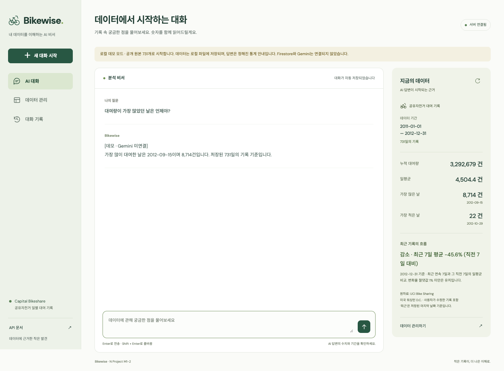
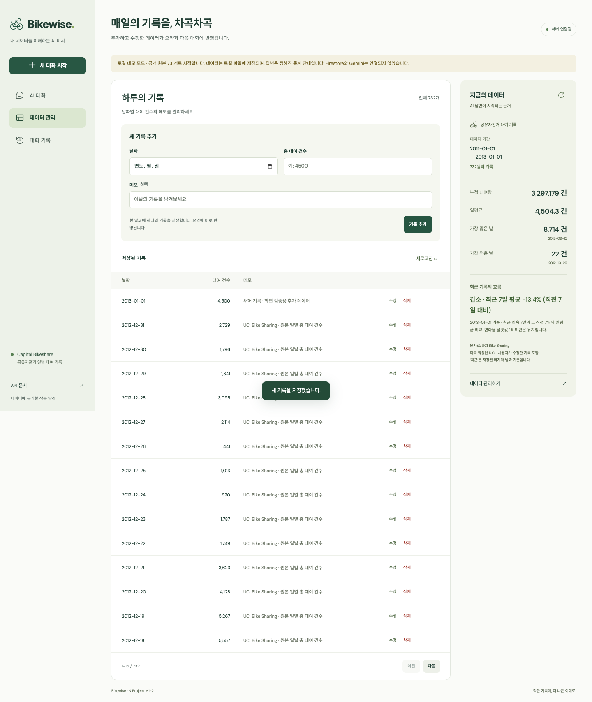
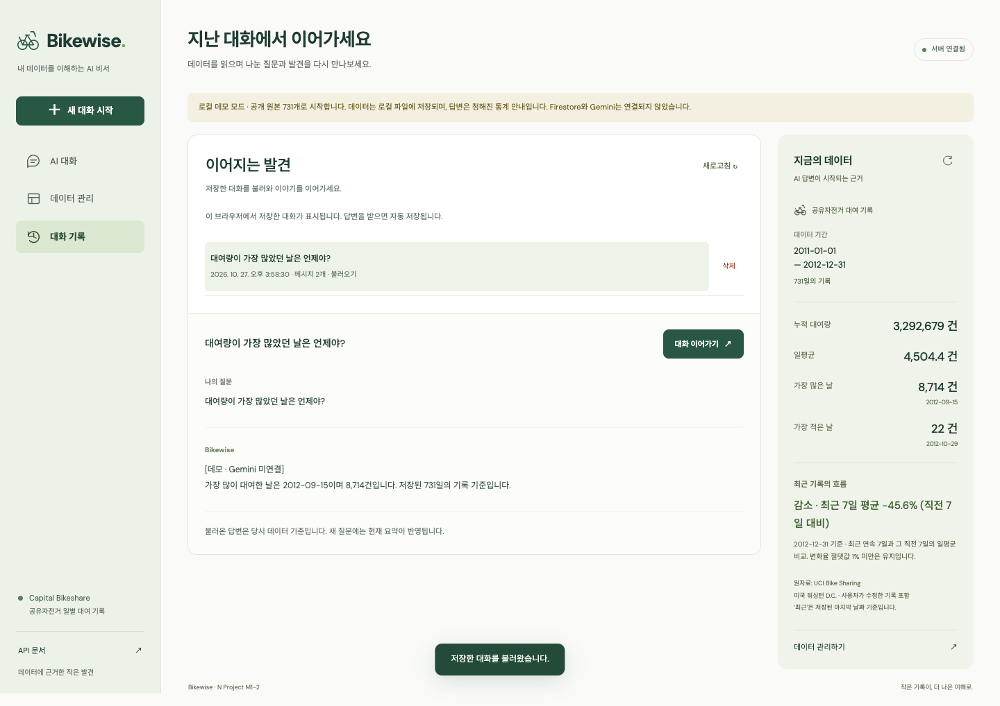

# Bikewise — 내 데이터를 이해하는 AI 비서

공유자전거 대여 기록을 관리하고, 저장된 데이터의 통계에 근거해 질문에 답하는 웹 서비스다. [M1-1 분석 프로젝트](https://github.com/larklaon/N_Project_M1-1)의 UCI Bike Sharing 일별 데이터 731개를 활용한다.

**사용자 요청에 따라 AI는 Gemini 3.8 Flash(`gemini-3.8-flash`)로 구현했다.** 과제 원문의 OpenAI/GPT API 사용 조건과 다른 부분이다. 보너스 과제는 구현 범위에서 제외했다.

현재 상태는 **로컬 구현·테스트와 실제 Gemini 응답 검증 완료, Firestore 연결 및 외부 배포 진행 중**이다. 아래 스크린샷은 로컬 데모를 실행해 촬영한 화면으로, 실제 Gemini 답변이나 배포 완료 증거가 아니다.

## 1. 서비스 소개와 필수 기능

일반적인 챗봇이 알지 못하는 사용자의 데이터를 서버에서 요약해 AI에게 제공한다. 데이터 수정 이후의 새 질문에는 변경된 통계가 반영된다.

| 기능 | 구현 내용 |
| --- | --- |
| 데이터 기반 AI 채팅 | DB 전체 데이터 요약 → 시스템 프롬프트 주입 → Gemini 호출 → 답변과 대화 자동 저장 |
| 로딩·오류 안내 | 답변 준비 중 표시, 중복 전송 방지, 요청 실패 시 질문 복원, 첫 서버 연결 지연 안내 |
| 데이터 CRUD | 날짜·대여 건수·메모 추가/조회/수정/삭제, 날짜 중복 방지, 목록 페이지 이동 |
| 데이터 요약 | 기간, 개수, 합계, 일평균, 최댓값·최솟값과 날짜, 최근 추세 |
| 대화 기록 | 자동 저장, API를 통한 수동 저장, 목록 조회, 전체 메시지 불러오기, 이어가기, 삭제 |
| API 문서 | FastAPI Swagger `/docs`, OpenAPI `/openapi.json` |
| 배포 준비 | Render Blueprint, Vercel 정적 빌드 설정, 서버 URL의 환경변수 주입 |

## 2. 기술 스택과 프로젝트 구조

- 백엔드: Python 3.10 이상, FastAPI, Uvicorn, Pydantic
- 데이터베이스: Firebase Firestore, Firebase Admin SDK
- AI: Google Gen AI SDK(`google-genai`), Gemini 3.8 Flash
- 프론트엔드: HTML/CSS/JavaScript. 프레임워크와 UI 라이브러리 없이 구현
- 배포 대상: Render(백엔드), Vercel(프론트엔드)
- 검증: pytest, FastAPI TestClient, Chromium 브라우저 동작 확인

```text
.
├── README.md                     # 구현 보고서, 실행·배포 방법, 검증 범위
├── .env.example                  # 환경변수 예시. 실제 .env는 Git 제외
├── render.yaml                   # Render 백엔드 배포 설정
├── firestore.rules               # 클라이언트의 Firestore 직접 접근 차단
├── backend/
│   ├── main.py                   # uvicorn 실행 진입점
│   ├── requirements.txt
│   ├── requirements-dev.txt
│   ├── app/
│   │   ├── main.py               # 앱 수명주기, CORS, 예외 처리, 라우터 등록
│   │   ├── config.py             # 환경변수 로드
│   │   ├── models.py             # Pydantic 요청·응답 스키마
│   │   ├── dependencies.py       # 저장소와 브라우저 세션 의존성
│   │   ├── store.py              # Firestore와 로컬 데모 저장소
│   │   ├── routers/              # data, conversations, chat HTTP API
│   │   └── services/             # 통계 계산, 프롬프트 구성, Gemini 호출
│   ├── scripts/seed.py           # Firestore에 원본 데이터 최초 적재
│   └── tests/test_app.py
├── frontend/
│   ├── index.html
│   ├── styles.css
│   ├── app.js
│   ├── config.js                 # 로컬 개발 서버 주소
│   ├── scripts/build.mjs         # API_BASE_URL → 공개 config.js 생성
│   └── vercel.json
├── data/raw/day.csv              # 수정하지 않은 UCI 원본 731행
├── data/raw/Readme.txt            # 원본 데이터 설명
├── data/source.json              # 출처, 라이선스, SHA-256
└── docs/screenshots/             # 실제 로컬 데모 동작 화면
```

라우터는 HTTP 요청·응답과 상태 코드를 담당하고, 서비스는 통계 계산과 AI 호출을 담당한다. 저장소 구현은 Firestore 접근을 한곳에 모아 로컬 검증에서 외부 계정 없이 동일한 API 동작을 확인할 수 있게 했다. 프론트엔드는 백엔드 API만 호출하며 비밀키나 Firestore 서비스 계정 키를 받지 않는다.

## 3. 데이터 선정과 요약 계산

원자료는 미국 워싱턴 D.C. Capital Bikeshare의 **2011-01-01~2012-12-31, 일별 731행**이다. 원본 `dteday`를 `date`, `cnt`를 `value`로 옮기고 출처 메모를 추가한다. 이 서비스에서 `value`는 고유 이용자 수가 아닌 **하루 총 대여 건수**다. 원본 날짜는 한국 시간으로 변환하지 않는다.

| 원본 기준 지표 | 값 |
| --- | ---: |
| 데이터 개수 | 731개 |
| 총 대여 건수 | 3,292,679건 |
| 일평균 | 약 4,504.35건 |
| 최댓값 | 8,714건, 2012-09-15 |
| 최솟값 | 22건, 2012-10-29 |

원본 CSV의 SHA-256과 고유 날짜 731개를 확인한 뒤 적재한다. 초기 적재는 같은 날짜의 기존 데이터를 덮어쓰지 않는다. UI에서 원본 데이터를 수정하거나 삭제해도 저장소에 보관한 원본 CSV는 바뀌지 않는다.

`GET /api/data/summary`는 현재 DB의 데이터를 날짜순으로 정렬해 다시 계산한다. 오래된 `summary.json`을 고정 응답으로 사용하지 않는다. 요약에는 월별·연도별 개수·합계·일평균도 포함해 기간을 묻는 질문에 근거를 제공한다.

최근 추세는 **저장된 마지막 날짜를 끝으로 하는 연속 7일의 일평균**과 **그 직전 연속 7일의 일평균**을 비교한다.

```text
변화율(%) = (최근 7일 평균 / 직전 7일 평균 - 1) × 100
절댓값 1% 미만: 유지 / 양수: 증가 / 음수: 감소
```

필요한 날짜가 빠져 있거나 직전 평균이 0이면 비교 불가로 표시한다. 결측 날짜를 0건으로 채우지 않는다. 최댓값·최솟값에 동률이 있으면 가장 이른 날짜를 표시한다. 현재 날짜와 저장된 최신 날짜를 구분하며, 과거 자료를 오늘의 실적으로 설명하지 않도록 프롬프트에도 명시했다. 날씨·사건 원인이나 인과관계는 현재 요약만으로 확정하지 않는다.

## 4. 로컬 실행

Python 3.10 이상을 설치한다. 의존성을 고정한 로컬 검증 환경은 Python 3.13.7이다. 정적 프론트엔드 빌드에는 Node.js 20.12 이상을 사용한다.

### 4.1 설치

저장소 루트에서 실행한다.

```bash
python3 -m venv .venv
source .venv/bin/activate
python -m pip install -r backend/requirements-dev.txt
cp .env.example .env
```

Windows의 가상환경 활성화 명령은 `.venv\Scripts\activate`다. 이미 `.env`가 있다면 복사해 덮어쓰지 않고 필요한 값을 수정한다.

### 4.2 키 없이 확인하는 로컬 데모

`.env`에서 `DEMO_MODE=true`로 설정한다.

```bash
cd backend
uvicorn main:app --reload --host 127.0.0.1 --port 8000
```

별도 터미널을 열어 저장소 루트에서 실행한다.

```bash
python3 -m http.server 3000 --bind 127.0.0.1 --directory frontend
```

- 프론트엔드: [http://localhost:3000](http://localhost:3000)
- 백엔드 상태: [http://127.0.0.1:8000/health](http://127.0.0.1:8000/health)
- Swagger: [http://127.0.0.1:8000/docs](http://127.0.0.1:8000/docs)

데모는 처음 실행할 때 원본 731개를 `.local/demo.json`에 준비한다. CRUD와 대화는 이 파일에 저장되어 같은 파일로 재시작하면 유지된다. 답변은 **정해진 통계 템플릿**이며 실제 Gemini 호출이 아니다. 화면과 답변에 데모임을 표시한다. 데모 저장소는 로컬 단일 프로세스용이다. 실제 Firestore/Gemini 설정이 빠진 경우 자동으로 데모로 대체하지 않는다.

### 4.3 실제 Firestore와 Gemini 연결

1. Firebase 프로젝트에서 Firestore Database를 생성한다. 서비스 계정 키를 발급하고, 해당 프로젝트에 필요한 Firestore 접근 권한을 부여한다.
2. 서비스 계정 JSON 전체를 `FIREBASE_SERVICE_ACCOUNT_JSON`에 넣거나, 프로젝트 밖에 보관한 JSON 파일의 절대경로를 `FIREBASE_SERVICE_ACCOUNT_PATH`에 넣는다. 둘 중 하나만 설정하면 된다.
3. [Google AI Studio](https://aistudio.google.com/apikey)에서 발급한 키를 `GEMINI_API_KEY`에 설정한다. `GEMINI_MODEL=gemini-3.8-flash`, `DEMO_MODE=false`로 설정한다.
4. 로컬 데모 백엔드를 중지하고, 저장소 루트에서 다음 명령으로 Firestore에 데이터를 적재한다.

```bash
source .venv/bin/activate
cd backend
python -m scripts.seed
uvicorn main:app --reload --host 127.0.0.1 --port 8000
```

초기 적재는 날짜별 트랜잭션을 사용하므로 731개 처리에 시간이 걸릴 수 있다. 재실행 시 기존 날짜를 보존한다. 키는 채팅, README, 프론트엔드 코드, Git에 넣지 않는다. 키를 설정한 후에는 실제 `/health`의 `database=firestore`, `demo=false`와 채팅 응답을 확인해야 한다.

## 5. 환경변수

| 변수 | 위치 | 의미·기본값 |
| --- | --- | --- |
| `DEMO_MODE` | 백엔드 | 기본 `false`. 로컬 데모일 때만 `true` |
| `GEMINI_API_KEY` | 백엔드 비밀값 | Gemini API 키. 실제 연결 시 필수 |
| `GEMINI_MODEL` | 백엔드 | 기본 `gemini-3.8-flash` |
| `FIREBASE_SERVICE_ACCOUNT_JSON` | 백엔드 비밀값 | 서비스 계정 JSON 전체 |
| `FIREBASE_SERVICE_ACCOUNT_PATH` | 백엔드 | JSON 대신 사용하는 로컬 키 파일 경로 |
| `ALLOWED_ORIGINS` | 백엔드 | 쉼표로 구분한 정확한 프론트 출처. 로컬 기본값은 `http://localhost:3000,http://127.0.0.1:3000` |
| `MAX_OUTPUT_TOKENS` | 백엔드 | 기본 800, 설정 범위 64~2000 |
| `CHAT_REQUESTS_PER_MINUTE` | 백엔드 | 프로세스 전체 분당 AI 요청 상한. 기본 5 |
| `CHAT_REQUESTS_PER_DAY` | 백엔드 | 프로세스 전체 UTC 날짜별 요청 상한. 기본 100 |
| `DEMO_DATABASE_PATH` | 백엔드, 선택 | 데모 파일 경로. 기본 `.local/demo.json` |
| `API_BASE_URL` | 프론트 빌드 | Render 서버의 HTTPS 주소. 키가 아닌 공개 설정 |

바닐라 브라우저 JavaScript는 배포 서버의 환경변수를 직접 읽을 수 없다. 따라서 빌드 스크립트가 `API_BASE_URL`만 공개 `dist/config.js`로 생성한다. Gemini·Firebase 키는 이 파일에 포함하지 않는다. 로컬에서 빌드할 때는 루트 `.env`를 읽지만, 개발용 원본 `frontend/config.js`는 로컬 주소로 고정되어 있다. 주소 변경을 적용하려면 빌드한 `frontend/dist`를 제공한다.

## 6. API와 검증 규칙

| 메서드 | 경로 | 동작 |
| --- | --- | --- |
| POST | `/api/data` | 새 날짜의 데이터 추가 |
| GET | `/api/data` | 목록. `offset`, `limit`(1~100), `start`, `end` 지원 |
| PUT | `/api/data/{id}` | 날짜·건수·메모 수정. 날짜 변경도 가능 |
| DELETE | `/api/data/{id}` | 기록 삭제 |
| GET | `/api/data/summary` | DB 전체 기록 요약 |
| POST | `/api/conversations` | 제목·messages를 새 대화 사본으로 저장 |
| GET | `/api/conversations` | 현재 세션 대화 목록. **messages 제외** |
| GET | `/api/conversations/{id}` | 특정 대화의 전체 messages 조회 |
| DELETE | `/api/conversations/{id}` | 대화 삭제 |
| POST | `/api/chat` | 질문, 선택적인 conversation_id로 답변 생성·자동 저장 |

데이터의 `id`는 `YYYY-MM-DD` 날짜다. 같은 날짜는 한 번만 저장되며 중복은 409다. 날짜를 수정할 때는 기존 문서와 새 날짜의 충돌을 트랜잭션으로 검사한다. 날짜 변경 후에는 응답의 새 `id`를 사용한다.

Pydantic으로 날짜, 0~10,000,000 범위의 정수 건수, 최대 500자 메모를 검증한다. 소수·문자열 숫자·불리언을 대여 건수로 허용하지 않는다. 질문은 공백 제외 1~2000자, 저장 메시지는 최대 80개, 메시지당 12000자, 본문 전체는 UTF-8 600KB 이하다. 요청에 정의하지 않은 필드는 거부한다. 잘못된 입력은 422, 없는 항목은 404로 응답한다.

대화 API는 `X-Session-ID` 헤더(32~128자)가 필요하다. 브라우저는 무작위 세션 키를 localStorage에 저장하고 서버는 해시만 DB에 저장한다. 목록·조회·삭제·이어가기 모두 같은 키의 대화만 접근한다. Swagger 테스트 시 32자 이상 임의 값을 넣고 같은 값을 재사용한다. 이 키는 인증 계정이 아닌 대화 접근용 비밀값이며, 브라우저 저장소를 지우면 기존 대화를 찾을 수 없다. 기기 간 로그인·동기화는 제공하지 않는다.

데이터 목록 응답은 `{items, total, offset, limit}`이고 최신 날짜가 먼저 나온다. 대화 목록은 갱신 시각 내림차순이며 `{id, title, created_at, updated_at, message_count}`를 반환한다. 메시지는 상세 API로 불러온다.

## 7. Firestore 구조와 컨텍스트 주입

```text
data/{YYYY-MM-DD}
  id, date, value, memo, created_at, updated_at

conversations/{UUID}
  id, owner(세션 키 해시), title, messages[{role, content}],
  revision, created_at, updated_at
```

날짜와 시간은 각각 ISO 날짜 문자열, UTC ISO 시각 문자열로 저장한다. 대화 목록에는 `owner` 동등 조건을 사용하고 서버에서 시각순으로 정렬해 복합 인덱스 없이 동작한다. 서비스 계정은 백엔드에서만 사용한다. 제공한 `firestore.rules`는 브라우저 클라이언트의 직접 접근을 차단하기 위한 것으로, Firebase 콘솔에서 적용해야 한다. Admin SDK는 이 규칙 대신 서비스 계정 IAM 권한으로 접근한다.

채팅은 다음 순서로 처리한다.

```text
사용자 질문 + 대화 ID
→ Firestore의 현재 데이터 조회
→ summary 서비스에서 기간·기본 통계·추세·월/연도 집계 계산
→ 시스템 지시문에 요약 JSON 삽입
→ 이전 대화 + 새 질문을 Gemini 3.8 Flash에 전달
→ 완성된 텍스트 답변 확인
→ conversations에 사용자 질문과 답변 함께 저장
→ 화면에 답변과 저장 결과 표시
```

`/api/data/summary`와 `/api/chat`은 같은 요약 함수를 사용한다. 백엔드가 자기 HTTP API를 다시 호출하지 않아 불필요한 네트워크 요청을 줄인다. 시스템 프롬프트는 한국어 답변, 수치·기간 근거, 현재 날짜와 데이터 기준일 구분, 정보 부족 인정, 인과관계 단정 금지를 지시한다. 메모의 지시문을 시스템 프롬프트에 그대로 넣지 않는다.

공식 SDK의 `models.generate_content`와 `system_instruction`을 사용하고, 이전 assistant 메시지는 Gemini의 `model` 역할로 변환한다. 최근 최대 21개 메시지를 전달하며 원본 전체 대화는 Firestore에 보존한다. 추론 수준은 `low`, 출력 한도는 기본 800토큰이다. 최대 토큰으로 잘렸거나 빈 응답인 경우 성공으로 저장하지 않는다. 외부 도구 호출은 사용하지 않는다.

AI 실패 시 불완전한 대화를 새로 저장하지 않고, 화면 입력을 복원한다. 기존 대화 갱신은 `revision` 비교 트랜잭션을 사용해 겹친 요청이 다른 답변을 덮어쓰는 것을 막는다. 통신이 끊겼다면 서버에서 이미 저장되었을 수 있으므로 자동 재전송하지 않고 대화 기록 확인을 안내한다. 생성 성공 후 DB 저장이 실패한 경우 생성 비용은 발생할 수 있다.

## 8. 배포 URL과 배포 방법

| 대상 | URL | 현재 상태 |
| --- | --- | --- |
| Vercel 프론트엔드 | 미발급 | 계정 설정 및 배포 필요 |
| Render 백엔드 API | 미발급 | 계정·키 설정 및 배포 필요 |
| Render Swagger | 백엔드 배포 URL 뒤 `/docs` | 배포 후 확인 필요 |

실제로 발급받은 주소를 배포 후 위 표에 기록한다. 예시 도메인을 배포 완료 주소로 표시하지 않는다.

### Render

1. 코드를 GitHub 저장소에 푸시하고 Render에서 해당 저장소를 연결한다.
2. Blueprint로 루트의 `render.yaml`을 사용하거나 Web Service를 생성한다. 수동 설정은 저장소 루트를 Root Directory로 사용한다.
3. Build Command: `pip install -r backend/requirements.txt`
4. Start Command: `cd backend && uvicorn main:app --host 0.0.0.0 --port $PORT --workers 1`
5. 환경변수 `DEMO_MODE=false`, `GEMINI_API_KEY`, `GEMINI_MODEL=gemini-3.8-flash`, `FIREBASE_SERVICE_ACCOUNT_JSON`, `ALLOWED_ORIGINS`를 설정한다. 키 값은 Render의 환경변수 관리 화면에만 입력한다.
6. 로컬에서 같은 Firebase 프로젝트에 초기 적재를 실행한다. 운영 시작 시 자동 적재하지 않는다.
7. 발급된 URL의 `/health`, `/docs`, `/api/data/summary`와 실제 채팅을 확인한다.

### Vercel

1. 같은 GitHub 저장소를 Import하고 **Root Directory를 `frontend`**로 설정한다.
2. Framework Preset은 Other, Build Command는 `npm run build`, Output Directory는 `dist`를 사용한다.
3. 환경변수 `API_BASE_URL`에 Render의 HTTPS 서버 주소를 넣고 배포한다. 뒤에 `/api`나 `/docs`를 붙이지 않는다. 미설정 시 배포 빌드를 실패시켜 잘못된 로컬 주소가 배포되는 것을 방지한다.
4. 발급된 Vercel 출처를 Render의 `ALLOWED_ORIGINS`에 정확히 추가하고 백엔드를 재배포한다. 주소에는 경로를 넣지 않는다. 미리보기 배포 주소는 허용 목록에 별도 추가해야 한다.
5. Vercel에서 채팅, CRUD, 대화 불러오기를 확인하고 실제 연결 화면으로 제출 스크린샷을 교체한다.

로컬 정적 빌드는 저장소 루트에서 `npm --prefix frontend run build`로 수행한다. 배포 시 환경변수 변경은 재빌드에 반영된다. Render 무료 인스턴스의 슬립으로 첫 요청이 지연될 수 있어, 화면은 8초 이후 서버 시작 안내를 표시하고 최대 90초 기다린다. 실패하면 상단 연결 버튼으로 다시 확인할 수 있다.

## 9. 보안·비용·운영 범위

- 비밀키와 `.env`, 서비스 계정 파일, 데모 DB를 Git에서 제외한다. 브라우저에는 공개 서버 주소만 전달한다.
- CORS는 허용된 프론트 출처만 지정한다. CORS 자체가 사용자 인증이나 직접 API 호출 차단 수단은 아니다.
- 대화는 브라우저별 세션으로 분리하지만, **대여 데이터의 CRUD는 공용**인 학습용 서비스다. 민감한 개인 데이터를 넣지 않는다. 실사용으로 확장하려면 계정 인증과 데이터별 권한이 필요하다.
- AI 요청은 프로세스 전체 분당·일별 상한, 최대 출력 토큰, 45초 타임아웃, SDK 재시도 1회 시도(자동 추가 재시도 없음)로 제한한다. 실패한 외부 호출 시도도 요청 한도에 포함된다.
- 요청 한도는 메모리 기반으로 재시작 시 초기화되며 여러 프로세스 간 공유되지 않는다. 배포 설정은 단일 워커다. 이는 계정의 금액 상한을 보장하지 않으므로 실제 사용량은 AI Studio에서도 확인한다.
- 요약마다 현재 전체 데이터를 읽는다. 731개 규모의 과제용 구현이며, 대규모 데이터에는 증분 집계·캐시와 조회 비용 관리가 필요하다.
- Gemini 키 오류·접근 권한·모델 없음·요청량 초과·서버 오류·타임아웃을 사용자용 메시지로 바꾼다. 서버의 원본 오류나 비밀키를 응답에 노출하지 않는다.

## 10. 테스트와 제출 화면

저장소 루트에서 다음 명령으로 API 테스트를 실행한다. 테스트는 별도 임시 로컬 DB와 모의 Gemini 응답을 사용하며 실제 유료 API를 호출하지 않는다.

```bash
source .venv/bin/activate
python -m pytest -q
node --check frontend/app.js
npm --prefix frontend run build
```

2026-10-27 기준 API 테스트 **30개 통과**. 원본 통계 일치, CRUD·영속 저장·날짜 충돌, 잘못된 입력, 대화 저장·조회·삭제와 세션 분리, 자동 저장·이어가기, 변경된 데이터 반영, 중복 대화 갱신 방지, Gemini 요청의 모델·컨텍스트·이력·토큰 제한과 실제 SDK의 HTTP 직렬화, 외부 API 오류, 빈/불완전 응답 거부, CORS와 요청 제한을 검증했다.

Chromium에서는 PC/모바일 화면, 채팅 자동 저장, 기록 추가·수정·삭제, 요약 갱신, 대화 불러오기·이어가기, 요청 실패 시 입력 보존을 확인했다. 실제 Gemini 3.8 Flash에 원본 데이터 요약을 주입해 총 대여량 3,292,679건·일평균 4,504.35건·기간을 정확히 답하는 것을 확인했다. **실제 Firebase 프로젝트의 CRUD와 Render/Vercel 배포 접속 검증은 진행 중이다.**

### 데이터 요약이 보이는 채팅 화면

최대 대여량에 관한 질문과 통계 기반 데모 답변, 우측 요약을 함께 표시한다.



### 데이터 관리 화면

2013-01-01 기록을 추가하고 목록 732개·요약에 반영된 상태다. 이 기록은 브라우저 동작 검증용으로 생성했으며 촬영 후 수정·삭제해 원본 데이터 731개 상태로 되돌렸다.



### 대화 기록 불러오기 화면

목록에서 저장한 대화를 선택해 질문·답변 전체를 다시 표시한다. 이어가기 버튼으로 같은 대화에 새 질문을 추가할 수 있다.



## 11. 출처와 라이선스

- 원본 분석: [N_Project_M1-1](https://github.com/larklaon/N_Project_M1-1)
- 데이터: Fanaee-T, H. (2013). *Bike Sharing*. UCI Machine Learning Repository. [DOI: 10.24432/C5W894](https://doi.org/10.24432/C5W894)
- 데이터 페이지: [UCI Bike Sharing](https://archive.ics.uci.edu/dataset/275/bike+sharing+dataset)
- 데이터 라이선스: [CC BY 4.0](https://creativecommons.org/licenses/by/4.0/). 원본 CSV는 그대로 보존하고, 서비스용 필드 매핑·메모·집계·사용자 변경 기능을 추가했다. 원저작자가 본 서비스를 보증하는 것은 아니다.
- Gemini 모델: [Gemini 3.8 Flash 공식 문서](https://ai.google.dev/gemini-api/docs/models/gemini-3.8-flash)
- SDK: [Google Gen AI Python SDK](https://googleapis.github.io/python-genai/)
- 배포 참고: [Render FastAPI](https://render.com/docs/deploy-fastapi), [Vercel Build Configuration](https://vercel.com/docs/builds/configure-a-build)

코드와 문서 작성에는 OpenAI Codex를 사용했으며, 서비스의 실제 AI 제공자는 사용자 요청에 따른 Gemini다. 통계는 원본 데이터와 테스트로 확인했고, 문서의 연결·배포 상태는 확인된 범위만 기록했다.
